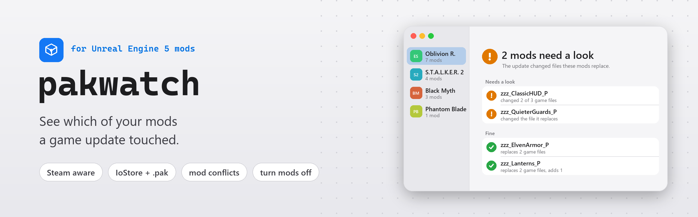
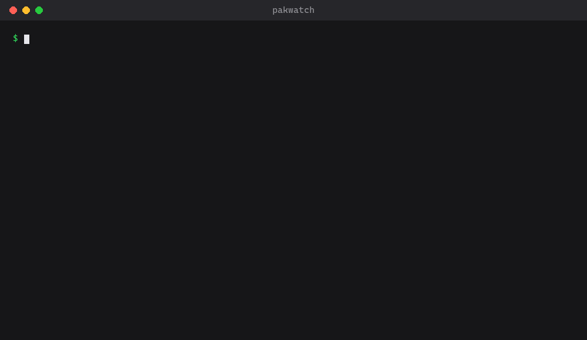

<p align="center">
  <a href="https://github.com/ayokiru/pakwatch/actions/workflows/test.yml"></a>
  <a href="https://pypi.org/project/pakwatch/"></a>
  <a href="https://github.com/ayokiru/pakwatch/releases/latest"></a>
  
  
  <a href="https://github.com/ayokiru/pakwatch/blob/main/LICENSE"></a>
</p>

<p align="center">
  <a href="https://github.com/ayokiru/pakwatch#get-started">Get started</a> &nbsp;·&nbsp;
  <a href="https://github.com/ayokiru/pakwatch#what-it-tells-you">What it tells you</a> &nbsp;·&nbsp;
  <a href="https://github.com/ayokiru/pakwatch#on-the-command-line">Command line</a> &nbsp;·&nbsp;
  <a href="https://github.com/ayokiru/pakwatch#how-it-works">How it works</a> &nbsp;·&nbsp;
  <a href="https://github.com/ayokiru/pakwatch#limits">Limits</a> &nbsp;·&nbsp;
  <a href="https://pypi.org/project/pakwatch/">PyPI</a>
</p>

Unreal Engine 5 games keep their files in IoStore containers, and pak mods replace some of those files. After a game update, a mod that replaces a file the update changed can crash the game or quietly undo a fix, and you only notice once you play. pakwatch remembers your game's files. After an update it shows which mods replace files that changed, so you know which ones to check for a new version.

<table>
  <tr>
    <td width="33%" valign="top">
      <br>
      <b>After an update</b><br>
      Which of your mods replace game files the update changed or removed, and how many files it changed in all.
    </td>
    <td width="33%" valign="top">
      <br>
      <b>Mod conflicts</b><br>
      Files two mods both replace. The game loads one version, so the other mod loses that part.
    </td>
    <td width="33%" valign="top">
      <br>
      <b>Turn mods off</b><br>
      Move a mod out of the game until its author catches up, and put it back with one click.
    </td>
  </tr>
  <tr>
    <td valign="top">
      <br>
      <b>Shareable report</b><br>
      Copy the report as Markdown for a mod's author or a bug report, without your local paths.
    </td>
    <td valign="top">
      <br>
      <b>IoStore and .pak mods</b><br>
      Reads only the tables of contents. No AES key, about a second for a whole game.
    </td>
    <td valign="top">
      <br>
      <b>Steam aware</b><br>
      Finds the Unreal Engine games in your Steam libraries and names the build before and after an update.
    </td>
  </tr>
</table>


<p align="center"><sub>Example data: the games are real, the mods and the update are made up for the picture.</sub></p>

## Get started

Download `pakwatch.exe` from the [latest release](https://github.com/ayokiru/pakwatch/releases/latest) and run it, or install it from [PyPI](https://pypi.org/project/pakwatch/) with Python 3.11 or newer:

```
pip install pakwatch
pakwatch
```

pakwatch opens in your browser and lists the Unreal Engine games in your Steam libraries. Pick one, or type the folder of a game that isn't on Steam.

The first check remembers the game as it is now, so run it while your mods work. Open pakwatch again after the next game update. The report then also says how many game files the update changed and, for Steam games, which build it went from and to.

From the report you can turn a mod off until its author catches up. pakwatch moves the mod's files out of the game, and Turn On puts them back where they were. Copy Report puts the whole report on the clipboard as Markdown, ready for a comment to the mod's author or a bug report, without any of your local paths.

## What it tells you

<table>
  <tr><td width="34%"> <b>Needs a look</b></td><td>The update changed or removed a game file this mod replaces. Look for a newer version of the mod.</td></tr>
  <tr><td width="34%"> <b>Updated by its author</b></td><td>The mod is newer than the update, so its author has probably caught up.</td></tr>
  <tr><td width="34%"> <b>Fine</b></td><td>None of the files it replaces changed.</td></tr>
  <tr><td width="34%"> <b>Only adds files</b></td><td>It replaces nothing, so an update can't clash with it.</td></tr>
  <tr><td width="34%"> <b>Replaced by more than one mod</b></td><td>Two mods replace the same file. The game loads one version, and the other mod loses that part.</td></tr>
</table>

## On the command line

Give it the game's folder and it prints the same report. Here it checks a game before an update, then after one, then prints the report as Markdown:

<p align="center"></p>
<p align="center"><sub>Example data, real pakwatch output.</sub></p>

The exit code is 0 when everything is fine, 1 when the update touched a mod or two mods collide, and 2 when the folder can't be read, so scripts and mod managers can act on it. Add `--markdown` to get the shareable version of the report instead. `pakwatch --no-browser` starts the window without opening it and prints its address.

## How it works

- pakwatch reads only the tables of contents (`.utoc`) of the game's containers. It never opens the data in `.ucas`, so it needs no AES key, and a whole game takes about a second.
- Every file in a container has a content hash. pakwatch keeps the hashes of all game files, a few MB per game in `%LOCALAPPDATA%\pakwatch`, and compares them after an update.
- A mod is any `*_P` container, or anything in a subfolder of `Paks` such as `~mods`.
- Mods packed as a plain `.pak` work too. Their index lists file paths without hashes, so pakwatch turns each path into the package id the game uses (CityHash64 of the package name) and matches it against the game's files.
- The report compares with the game as it was before the last update, so it keeps showing what that update touched until the next one.

## Privacy and safety

pakwatch only reads files, except when you press Turn Off or Turn On. Those move one mod's files between the game's `Paks` folder and `%LOCALAPPDATA%\pakwatch`, and never delete or overwrite anything. pakwatch never connects to the internet. The window is a page served on 127.0.0.1 with a one-time key, so other sites open in your browser can't use it, and it shuts down shortly after you close the tab.

## Limits

- It works with IoStore games, which is most Unreal Engine 5 games. The game's own `.pak` files aren't read, because their file index is usually encrypted. A mod with an encrypted index is listed under "Couldn't read".
- A changed file doesn't always break a mod, and an unchanged one doesn't prove it works. Treat the list as the places to check first.
- When a game encrypts its file index, file names come from the mod's own index, which is usually readable.
- `pakwatch.exe` isn't signed, so Windows SmartScreen may ask before its first start.

## License

[MIT](https://github.com/ayokiru/pakwatch/blob/main/LICENSE)
