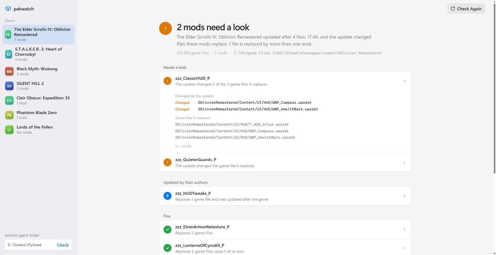

# pakwatch

See which mods a game update touched, before you find out in the game.

Unreal Engine 5 games keep their files in IoStore containers (`.utoc` + `.ucas`), and pak mods replace some of those files. After a game update, a mod that replaces a file the update changed can crash the game or quietly undo the fix. pakwatch remembers the game's files and, after an update, tells you which mods replace files that changed. It also lists files that two mods both replace, since only one of them can win.

```
> pakwatch "C:\Program Files (x86)\Steam\steamapps\common\MyGame"
304,986 game files. The game changed since 2026-11-03T21:40:12Z; mods compared with that version.

! zzz_Swords_P: patch touched, replaces 9 game files, adds 8
    changed: MyGame/Content/Weapons/BP_Sword.uasset

  zzz_Shields_P: ok, replaces 2 game files, adds 0
```

Run `pakwatch` without a folder and it opens in your browser instead. It finds the Unreal Engine games in your Steam libraries, and any other game folder works too.

<picture>
  <source media="(prefers-color-scheme: dark)" srcset="docs/window-dark.png">
  
</picture>

<sub>Example data: the games are real, the mods and the update are made up for the picture.</sub>

## How it works

- The first run remembers every game file by its content hash, a few MB in `%LOCALAPPDATA%\pakwatch`. Run it once while your mods work.
- After an update, the next run compares the game with that snapshot and flags each mod that replaces a file the update changed or removed. A mod written after the update shows as "updated after patch", because its author has probably caught up.
- pakwatch reads only the container tables. It never opens the `.ucas` data, needs no AES key and changes nothing. A whole game takes about a second.
- Mods are `*_P` containers and anything in a subfolder of `Paks`, such as `~mods`.
- The window is a page served on 127.0.0.1 with a one-time key, so other sites in the browser can't use it. It stops shortly after you close the tab.

The exit code is 1 when the update touched a mod or two mods collide, so pakwatch can run in scripts.

## Install

```
pip install git+https://github.com/ayokiru/pakwatch
pakwatch                  # opens in your browser
pakwatch <game folder>    # prints the report
```

Needs Python 3.11 or newer and nothing else.

## Limits

- Only IoStore games, which is most UE5 games. Mods that ship only a `.pak` aren't read yet.
- A changed file doesn't always break a mod, and an unchanged one doesn't prove it works, so treat the list as the places to check first.
- When the game encrypts its file index, names come from the mod's own index, which is usually readable.

## License

MIT
