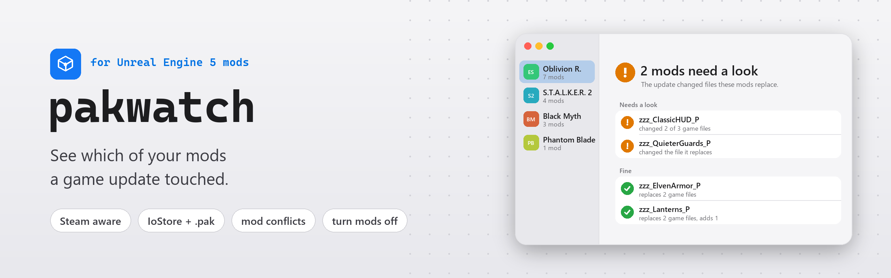
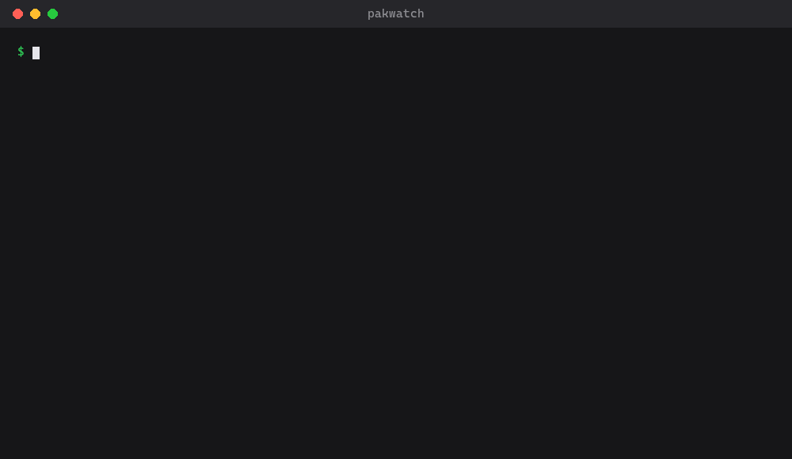

<picture>
  <source media="(prefers-color-scheme: dark)" srcset="docs/banner-dark.png">
  
</picture>

<p align="center">
  <a href="https://github.com/ayokiru/pakwatch/actions/workflows/test.yml"></a>
  <a href="https://pypi.org/project/pakwatch/"></a>
  <a href="https://github.com/ayokiru/pakwatch/releases/latest"></a>
  
  
  <a href="LICENSE"></a>
</p>

<p align="center">
  <a href="#get-started">Get started</a> &nbsp;·&nbsp;
  <a href="#what-it-tells-you">What it tells you</a> &nbsp;·&nbsp;
  <a href="#on-the-command-line">Command line</a> &nbsp;·&nbsp;
  <a href="#check-after-every-steam-update">Watch</a> &nbsp;·&nbsp;
  <a href="#how-it-works">How it works</a> &nbsp;·&nbsp;
  <a href="#limits">Limits</a> &nbsp;·&nbsp;
  <a href="https://pypi.org/project/pakwatch/">PyPI</a>
</p>

Unreal Engine 5 games keep their files in IoStore containers, and pak mods replace some of those files. After a game update, a mod that replaces a file the update changed can crash the game or quietly undo a fix, and you only notice once you play. pakwatch remembers your game's files. After an update it shows which mods replace files that changed, and which mods use changed files from their own assets, so you know which ones to check for a new version.

<table>
  <tr>
    <td width="33%" valign="top">
      <br>
      <b>After an update</b><br>
      Which of your mods replace game files the update changed or removed, or use them from their own files.
    </td>
    <td width="33%" valign="top">
      <br>
      <b>Mod conflicts</b><br>
      Files two mods both replace, and which mod's version the game loads.
    </td>
    <td width="33%" valign="top">
      <br>
      <b>Turn mods off</b><br>
      Move a mod out of the game until its author catches up, and put it back with one click.
    </td>
  </tr>
  <tr>
    <td valign="top">
      <br>
      <b>Shareable report</b><br>
      Copy the report as Markdown for a mod's author or a bug report, without your local paths.
    </td>
    <td valign="top">
      <br>
      <b>IoStore and .pak mods</b><br>
      Reads only the tables of contents. No AES key, about a second for a whole game.
    </td>
    <td valign="top">
      <br>
      <b>Steam aware</b><br>
      Finds the Unreal Engine games in your Steam libraries, and can check them by itself after every Steam update.
    </td>
  </tr>
</table>

<picture>
  <source media="(prefers-color-scheme: dark)" srcset="docs/window-dark.png">
  
</picture>
<p align="center"><sub>Example data: the games are real, the mods and the update are made up for the picture.</sub></p>

## Get started

Download `pakwatch.exe` from the [latest release](https://github.com/ayokiru/pakwatch/releases/latest) and run it, or install it from [PyPI](https://pypi.org/project/pakwatch/) with Python 3.11 or newer:

```
pip install pakwatch
pakwatch
```

pakwatch opens in your browser and lists the Unreal Engine games in your Steam libraries. Pick one, or type the folder of a game that isn't on Steam.

The first check remembers the game as it is now, so run it while your mods work. Open pakwatch again after the next game update. The report then also says how many game files the update changed and, for Steam games, which build it went from and to.

From the report you can turn a mod off until its author catches up. pakwatch moves the mod's files out of the game, and Turn On puts them back where they were. Copy Report puts the whole report on the clipboard as Markdown, ready for a comment to the mod's author or a bug report, without any of your local paths.

## What it tells you

<table>
  <tr><td width="34%"> <b>Needs a look</b></td><td>The update changed or removed a game file this mod replaces. Look for a newer version of the mod.</td></tr>
  <tr><td width="34%"> <b>Uses changed game files</b></td><td>The mod replaces nothing that changed, but its own files use game files the update changed or removed, for example an effect or a blueprint it builds on. Check for a newer version too.</td></tr>
  <tr><td width="34%"> <b>Updated by its author</b></td><td>The mod is newer than the update, so its author has probably caught up.</td></tr>
  <tr><td width="34%"> <b>Fine</b></td><td>None of the files it replaces changed.</td></tr>
  <tr><td width="34%"> <b>Only adds files</b></td><td>It replaces nothing, so an update can't clash with it.</td></tr>
  <tr><td width="34%"> <b>Replaced by more than one mod</b></td><td>Two mods replace the same file. The game loads one version, and the other mod loses that part. "loads:" names the mod whose version the game uses (see <a href="#limits">Limits</a>).</td></tr>
</table>

## On the command line

Give it the game's folder and it prints the same report. Here it checks a game before an update, then after one, then prints the report as Markdown:

<p align="center"></p>
<p align="center"><sub>Example data, real pakwatch output.</sub></p>

The exit code is 0 when everything is fine, 1 when the update touched a mod (Needs a look or Uses changed game files) or two mods collide, and 2 when the folder can't be read, so scripts and mod managers can act on it. Add `--markdown` to get the shareable version of the report instead. `pakwatch --no-browser` starts the window without opening it and prints its address.

## Check after every Steam update

```
pakwatch watch --install
```

This adds a shortcut to your Windows Startup folder, so `pakwatch watch` starts every time you log in. It looks at your Steam games with mods or UE4SS every ten minutes. When Steam has finished an update (the game's build id changed), pakwatch checks the game and shows a Windows notification with the game's name and a short result, such as "1 mod needs a look". Open pakwatch for the full report.

`pakwatch watch --uninstall` removes the shortcut. Add `--dry-run` to either command to see what it would do without changing anything. `pakwatch watch` on its own runs the watcher in the console until you close it, and `pakwatch watch --dry-run` checks once and prints instead of showing a notification. With `pakwatch.exe` the watcher runs in a minimized window; installed with pip it runs without one.

## UE4SS script mods

If the game has UE4SS, the report shows its version and the script mods in its `Mods` folder, with on or off as `mods.txt` and `enabled.txt` say. When an update also changed the game's exe, pakwatch adds a warning: script mods often break when the exe changes, so check for a new UE4SS and new versions of your script mods. pakwatch can't tell which script mod will break, because that depends on code in the exe, not on files it can compare.

## How it works

- pakwatch reads only the tables of contents (`.utoc`) of the game's containers. It never opens the data in `.ucas`, so it needs no AES key, and a whole game takes about a second.
- Every file in a container has a content hash. pakwatch keeps the hashes of all game files, a few MB per game in `%LOCALAPPDATA%\pakwatch`, and compares them after an update.
- A mod is any `*_P` container, or anything in a subfolder of `Paks` such as `~mods`.
- Mods packed as a plain `.pak` work too. Their index lists file paths without hashes, so pakwatch turns each path into the package id the game uses (CityHash64 of the package name) and matches it against the game's files.
- The report compares with the game as it was before the last update, so it keeps showing what that update touched until the next one.
- After an update pakwatch also reads one small chunk from each mod's `.ucas`, the container header. It lists the game packages every package in the mod imports, so a mod that adds its own asset built on a changed game asset shows up too. Package names come from the mod's package headers.
- Most mods store that chunk uncompressed. If it's packed with Oodle, pakwatch uses the game's own `oo2core` DLL when the game ships one. Otherwise the mod says "imports not readable" and the rest of its report still works.

## Privacy and safety

pakwatch never changes the game's files on its own. Turn Off and Turn On move one mod's files between the game's `Paks` folder and `%LOCALAPPDATA%\pakwatch`, and never delete or overwrite anything. `pakwatch watch --install` and `--uninstall` add or remove one shortcut in your Startup folder. The watcher keeps the last Steam build id of each game in `%LOCALAPPDATA%\pakwatch\watch.json`. When a mod's container header is packed with Oodle, pakwatch loads the game's own Oodle DLL to unpack it. pakwatch never connects to the internet. The window is a page served on 127.0.0.1 with a one-time key, so other sites open in your browser can't use it, and it shuts down shortly after you close the tab.

## Limits

- It works with IoStore games, which is most Unreal Engine 5 games. The game's own `.pak` files aren't read, because their file index is usually encrypted. A mod with an encrypted index is listed under "Couldn't read".
- A changed file doesn't always break a mod, and an unchanged one doesn't prove it works. Treat the list as the places to check first.
- When a game encrypts its file index, file names come from the mod's own index, which is usually readable.
- "loads:" follows what we saw in Phantom Blade Zero (Unreal Engine 5.7, tested in game twice): when two paks in `~mods` replace the same package, the one whose file name comes first in ASCII order wins, and capital letters sort before small ones, so `zzz_S...` beats `zzz_z...`. Other games may load mods in another order.
- Imports are read for IoStore mods only. A mod packed as a plain `.pak`, or an encrypted container, can't be checked for "Uses changed game files".
- The exe warning needs a snapshot taken by this version of pakwatch, and it only comes with an update that also changed the game's containers.
- `pakwatch.exe` isn't signed, so Windows SmartScreen may ask before its first start.

## License

[MIT](LICENSE)
